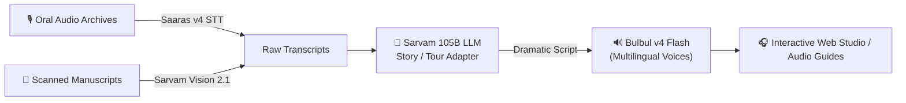

# 🏛️ Heritage Storytelling Agent
> Transforming ancient manuscripts and oral archives into dramatic multilingual audio tours and stories using **Sarvam AI**.

---

## 🌟 Overview
The **Heritage Storytelling Agent** is an end-to-end AI pipeline designed to preserve, revive, and celebrate cultural heritage across India:
1. **Transcribe & Translate Oral Archives & Manuscripts**: Ingests oral testimonies and elder recordings using **Saaras v4** (ASR) and parses scanned historical manuscripts using **Sarvam Vision 2.1** (Doc AI).
2. **Transform into Dramatic Audio Scripts**: Uses **Sarvam 105B** to craft evocative, spoken-word narratives, museum audio guides, and character dialogues.
3. **Multilingual Voice Narration**: Synthesizes expressive, natural voice narration and character dialogue using **Bulbul v4 Flash** with over 200+ persona voices.

---

## 🏗️ Architecture



---

## 🚀 Getting Started

### 1. Prerequisites
- Python 3.10+
- A Sarvam AI API subscription key from [Sarvam AI Dashboard](https://indus.sarvam.ai/key-management)

### 2. Installation
```bash
git clone https://github.com/shreyas0907/hakethonproject.git
cd hakethonproject
pip install -r requirements.txt
```

### 3. Environment Configuration
Create a `.env` file from the template:
```bash
cp .env.example .env
```
Add your key inside `.env`:
```env
SARVAM_API_KEY=your_actual_sarvam_api_key
```

---

## 📂 Project Structure

- `main.py` — Minimal verification test for the Sarvam AI SDK connection.
- `story_generator.py` — Converts historical notes/excerpts into immersive audio tour narration.
- `persona_studio.py` — Multi-character dramatization (Docent Narrator + Historical Figure) with distinct voice personas.
- `archive_ingestion.py` — Ingestion pipeline for oral audio (`Saaras v4`) and manuscript documents (`Sarvam Vision 2.1`).
- `player.html` — Interactive web-based audio player to explore generated stories and transcripts.

---

## 🎙️ Running the Pipeline

### Generate a Heritage Story
```bash
python story_generator.py
```

### Multi-Persona Character Dramatization
```bash
python persona_studio.py
```

### Ingest Oral Archives & Manuscripts
```bash
python archive_ingestion.py
```

### Open the Web Studio
```bash
open player.html
```

---

## 🛡️ License & Acknowledgements
Powered by the **Sarvam AI** model ecosystem:
- **Saaras v4**: Speech-to-Text with support for 22 Indic languages and code-mixing.
- **Sarvam 105B**: Indic cultural reasoning and conversational LLM.
- **Bulbul v4 Flash**: Fast, expressive Indian-language voice synthesis with 200+ personas.
- **Sarvam Vision 2.1**: High-accuracy document intelligence and OCR.
